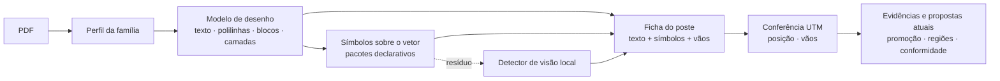

# Leitura vetorial por poste — design

> 2026-10-30 · base `1523aa1` · sessão do arquiteto

## Por quê

A leitura de projetos ainda é amadora. Na última rodada de curadoria, sobre 445 símbolos avaliáveis
em 16 folhas, o resultado foi TP 140 / FP 66 / FN 305. Os erros que mais custam: não identificar
simbologias e não associar texto e símbolo ao poste certo.

Só o PDF chega, não há DWG. Converter o PDF para DWG não acrescenta informação: produz as mesmas
linhas soltas que o PyMuPDF já lê, num formato proprietário. O ganho real está em **analisar o
vetor como desenho** em vez de como pixels.

## O que é sucesso

Para cada poste da folha, a análise entrega uma **ficha do poste** correta:

- identificador (`P7`), estrutura (`N1`, `U3(2)`, `S1N`…), poste (`11-300`) e coordenada UTM;
- vãos ligados a ele, com comprimento e cabo;
- símbolos associados: estais, para-raios MT/BT, transformadores e demais equipamentos do catálogo.

A precisão é medida **por poste**, contra referência congelada. A métrica atual de símbolos soltos
continua como diagnóstico secundário.

## Não objetivos e antiobjetivos

- Não gerar DWG. DXF existe só como artefato de depuração (ver Componentes).
- Não chamar IA externa em produção. O Claude entra só na rotulagem para treino.
- Não mexer em cliente, conformidade, exportação nem portabilidade, além do que a ficha exigir para
  aparecer (campos aditivos).
- **Antiobjetivo:** uma ficha errada apresentada com segurança. Quando as conferências não fecham, a
  análise marca pendência no lugar e não inventa valor.

## O que os PDFs reais mostram

Inspeção somente leitura dos 16 PDFs de `examples/` (2026-10-30):

| Família (sinal no PDF) | Qtde | Texto da rede | Camadas |
|---|---|---|---|
| Electric Office via `Microsoft: Print To PDF` | 8 | contorno vetorial (~600–2.200 formas preenchidas pequenas por folha); 0–4 rótulos de rede como texto | não |
| `iText 5.5.13.3` (carimbo/assinatura posterior) | 6 | texto nativo (11–45 rótulos de rede por folha) | não |
| `GPL Ghostscript` (PDFCreator) | 1 | contorno vetorial, sem texto | não |
| AutoCAD 2023 (`pdfplot16.hdi`) | 1 | texto nativo + `AutoCAD SHX Text` | 11 OCGs nomeados (`P`, `NOTAS`, `ESTRUEXI`, `Esforco`…) |

Todas têm ortofoto raster por baixo. Hipóteses a confirmar na F2:

- cada forma pequena preenchida é um glifo;
- os símbolos da rede são vetoriais em todas as famílias;
- as cerca de 250 imagens das folhas Print To PDF são só ladrilhos da ortofoto.

## Decisões

1. **Vetor primeiro, com modelo de desenho intermediário.** Cada página vira um *modelo de desenho*
   derivado, com estes elementos:
   - texto recuperado (nativo, SHX ou contorno de glifo), com posição, rotação e altura;
   - polilinhas da rede reconstruídas a partir de segmentos colineares e contíguos;
   - círculos e arcos recuperados de Béziers;
   - grupos de primitivas candidatos a símbolo ("blocos");
   - camada, cor e espessura.

   O modelo é dado derivado, como as evidências do ADR 0004: sai do cache e é descartável. A análise
   de símbolos e a montagem da ficha rodam sobre ele.
2. **Perfil por família de PDF.** A família é reconhecida por impressão estrutural (produtor, OCGs,
   razão entre texto nativo e contornos, presença de SHX). Ela não depende só do campo `producer`,
   porque o Electric Office chega via um driver de impressão genérico. O perfil escolhe as
   estratégias de recuperação de texto e camada. Família desconhecida usa o perfil genérico e gera
   diagnóstico.
3. **Texto em contorno é lido por forma, não por OCR.** O contorno de cada glifo é normalizado
   (translação, escala e rotação) e vira uma assinatura. A assinatura é resolvida numa **tabela de
   glifos versionada** em `adapters/analysis/data/`, como os pacotes de simbologia. Glifo
   desconhecido gera diagnóstico e é coletado para a fábrica de rótulos; não há palpite. O OCR atual
   fica como reserva até ser provado dispensável.

   A tabela começa assim: as assinaturas distintas de todas as folhas são agrupadas, e um
   representante de cada grupo é renderizado e rotulado por leitura dupla. A tabela guarda só as
   assinaturas de forma e o caractere, nunca recorte de PDF real. Uma fixture sintética com fonte
   livre prova o mecanismo.
4. **Conferência geométrica fecha a ficha.** Usando as coordenadas UTM lidas e a escala do carimbo,
   ajusta-se a transformação página → UTM com rejeição de outliers. A partir dela, a análise confere:
   - a posição de cada poste contra a coordenada escrita;
   - cada vão escrito contra a distância entre os postes.

   Divergência vira pendência localizada na ficha. Tolerâncias iniciais, por minha conta e
   calibráveis na F4: vão com diferença de até `max(2 m, 3%)`; posição com resíduo de até 3 m.
5. **Modelo de visão local, como última camada.** É um detector treinado que roda em CPU no container
   via ONNX Runtime. A licença do modelo e do código de treino é Apache-2.0, BSD ou MIT; YOLO
   Ultralytics (AGPL) está excluído. O detector só atua onde o vetor não resolveu e entra como
   evidência com confiança. O hash dos pesos entra na assinatura do analisador (ADR 0004/0006).
   Treino e dados ficam fora do servidor e do Git. Revisa o ADR 0001 nesse ponto.

   O treino roda na máquina do usuário (Windows, GPU AMD RX 9070 XT), em PyTorch com ROCm, nativo
   ou via WSL2. O suporte a essa GPU não foi verificado. A F7 começa com um spike que treina um
   modelo mínimo na GPU. Se falhar, o treino roda em CPU, ou se cogita GPU alugada por hora, que
   ainda depende de aval do usuário. Inferência no servidor é sempre em CPU.
6. **Rotulagem pelo Claude, com auditoria.** É a fábrica de rótulos:
   - pré-marcação automática pelo pipeline vetorial;
   - leitura dupla cega por subagentes, com divergências encaminhadas para conferência;
   - amostra humana de cerca de 5 folhas em 50 por lote, que mede a taxa de erro dos rótulos.

   O usuário autorizou o envio das folhas à Anthropic para esse fim (LGPD e contrato). Os rótulos
   **podem alimentar o treino**, o que revisa o invariante do fluxo de curadoria. O conjunto de
   avaliação é separado por folha, congelado e nunca usado no treino.

   A pré-marcação só vale para o conjunto de treino. O conjunto de avaliação continua com leitura
   cega, sem predições à vista, como manda o contrato de curadoria. As 16 folhas atuais já foram
   vistas no desenvolvimento e servem de desenvolvimento. A avaliação que decide a F5 e a F7 usa
   folhas novas, reservadas antes de qualquer correção.
7. **Substituição só com prova.** O analisador novo entra com versão própria de extrator e
   interpretador (nova identidade de execução, ADR 0006) e roda em paralelo ao atual no benchmark.
   As métricas por poste são:
   - precisão e recall de poste;
   - acerto exato de identificador, estrutura, poste e coordenada;
   - acerto de vão (comprimento e cabo);
   - precisão e recall dos símbolos associados ao poste certo.

   O analisador novo vira padrão quando atende às duas condições:
   - é ≥ o atual em todas essas métricas;
   - não regride em nenhuma folha sem justificativa.

   Só então os detectores substituídos e, se nenhuma família precisar, o OCR e o Tesseract saem do
   código e do container.

Alternativas descartadas:

- **Conversão para DWG:** sem informação nova, e exigiria SDK proprietário (ODA).
- **Claude no servidor a cada análise:** custo por folha, resultado não determinístico e serviço
  externo em produção.
- **OCR em DPI ainda maior:** continua sendo leitura aproximada de algo que é geometria exata.
- **Treinar um detector antes de medir o vetor:** só há 16 folhas, e a maior parte do erro está em
  texto e associação, que o vetor resolve.

## Fronteiras

- Tudo novo vive em `zeny_project_handler/adapters/analysis/` (modelo de desenho, perfis, glifos,
  detector) e em `application/` (montagem da ficha e conferência UTM, que são puras e testáveis sem
  PyMuPDF).
- A saída continua sendo `EvidenciaDocumento` e `PropostaElemento`/`PropostaRelacao`. Promoção,
  regiões, vãos e conformidade não mudam de contrato. Novos atributos entram em
  `atributos_extraidos`.
- A ficha do poste não é entidade persistida nova. Ela é a composição das propostas e relações
  atuais (poste, estruturas, equipamentos, cabos/vãos) com seus atributos. As pendências da
  conferência UTM viram pendências de revisão pelo mecanismo atual (`human_review`). Até a F5, nenhuma
  migração SQLite é necessária.
- O domínio não importa PyMuPDF, ONNX Runtime nem ezdxf.
- As fases F1 e F6 alteram a skill `.claude/skills/curadoria-simbologia` e os agentes
  `.claude/agents/curadoria-*`. Essas mudanças são feitas pela sessão de execução, não pelo
  arquiteto.
- Mudança de API, se a ficha ou as pendências precisarem aparecer no cliente, só por campos
  aditivos, com `docs/api/openapi-v1.json` regenerado.
- Dependências novas (ONNX Runtime, ezdxf) ficam nos locks do servidor ou de experimentos, nunca no
  cliente (`client_artifact_gate`). O treino tem lock próprio, opt-in.

## Fases (base do roadmap)

| Fase | Entrega | Pronto quando |
|---|---|---|
| F0 Limpeza | sai o que é de etapa encerrada (lista abaixo) | gate completo verde, sem mudança de comportamento |
| F1 Medição por poste | formato da ficha de referência, rotulagem v0 das 16 folhas (leitura dupla + amostra humana), benchmark por poste | baseline do analisador atual registrado em `tmp/` |
| F2 Modelo de desenho | perfis, polilinhas, blocos, texto nativo/SHX/contorno com tabela de glifos; DXF de depuração | texto da rede recuperado nas 4 famílias sem OCR, medido na F1 |
| F3 Símbolos e ficha | pacotes declarativos sobre o modelo; associação texto/símbolo → poste | benchmark por poste melhor que o baseline |
| F4 Conferência UTM | ajuste página → UTM, checagem de posição e vão, pendências | tolerâncias calibradas; nenhuma ficha divergente sem pendência |
| F5 Troca | analisador novo como padrão; remoção dos detectores substituídos e, se provado, do OCR/Tesseract | critério da decisão 7 |
| F6 Fábrica de rótulos | fluxo contínuo para cerca de 50 folhas/mês, conjunto de treino e avaliação versionado por hash fora do Git | primeiro lote com taxa de erro de rótulo medida |
| F7 Detector local | treino, exportação ONNX, adaptador no servidor para o resíduo | ganho no benchmark por poste sobre F5, sem regressão |

F6 pode começar em paralelo a partir da F2. F7 depende de F6 ter volume.

### Escopo da F0

- Remover os scripts de etapas encerradas e seus testes: `benchmark_*_e0N`, `*_e13`, `*_e14`,
  `*_e16*`, `stage1N_*`, `coverage_matrix_e16`, `curation_coverage_e16`, `visual_qa_*` e
  `scripts/experiments/`. Antes, conferir com grep quem ainda usa cada um; os CLIs `curation_*` e a
  skill podem depender deles.
- Remover `docs/roadmap-curadoria-simbologia-paralela.md`. A E11 fica sem efeito: o detector que a
  bloqueava vai ser substituído.
- README: tirar o histórico narrativo e manter uso e operação.
- Ficam: gates, build/release, OpenAPI, `smoke_examples`, `curation_*`, os ADRs e as regras de
  `CLAUDE.md`, que deve ser atualizado se citar algo removido.

## Restrições

- Fixtures sintéticas para todo comportamento novo. Exemplos: uma folha com texto em contorno e a
  mesma folha com texto nativo, com mesmo resultado esperado; folha com OCGs; glifo desconhecido.
- PDFs reais, rótulos, conjuntos de dados e pesos treinados nunca entram no Git. Os pesos são
  artefato de release com SHA-256.
- Documentação mínima: este design, os ADRs 0016 (vetor primeiro) e 0017 (detector local e rotulagem) e
  as atualizações pontuais em `CLAUDE.md` e no contrato de curadoria. Nada de histórico de execução
  em arquivo versionado.

## Fica a cargo de quem constrói

- Algoritmos de reconstrução de polilinhas, agrupamento de blocos e assinatura de glifo.
- Formato exato da ficha de referência e do relatório do benchmark por poste. Pode partir de
  `scripts/benchmark_network_pdf.py`.
- Arquitetura do detector (ex.: RT-DETR ou Faster R-CNN do torchvision), resolução dos recortes e
  limiar de confiança. O orçamento inicial é de até 60 s de inferência por folha em CPU, por minha
  conta.
- Onde ficam, fora do Git, o conjunto de dados e o lote mensal de folhas. Uma opção é uma subpasta
  ignorada, como `examples/`.
- Como as pendências da ficha aparecem no cliente, se aparecerem antes da F5.
