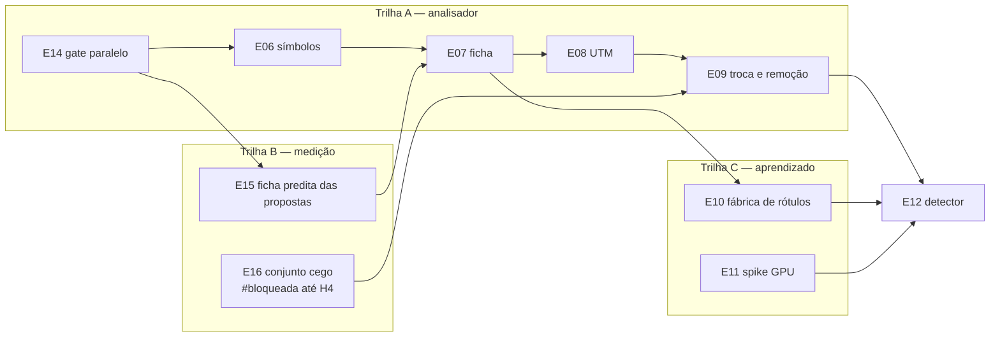

# Execução acelerada do roadmap de leitura vetorial por poste — design

> Data: 2026-11-04 · Autor: arquiteto · Altera: `docs/roadmap-leitura-vetorial-por-poste.md` (protocolo, índice, E07, E09, E11 e etapas novas E14–E16) · Não altera: design `2026-10-30-leitura-vetorial-por-poste-design.md`, ADRs 0016/0017, souls.

## Intenção

O usuário pediu que as etapas avancem mais rápido sem perder qualidade, usando paralelismo e subagentes onde couber. Uma etapa não pode passar de ~3h de relógio. Hoje ela leva de 5h a 15h.

## Evidência (o que medi)

| Fato | Fonte |
|---|---|
| E05 durou 07:22 → 22:38 (15h16); E04, 01:22 → 06:22 (5h); E03, 11:26 → 22:46 (11h20, com operação e amostra humana) | `git log` de `731ca5c..7096b76`, `6a1f438..019dfa8`, `9f50e35..ec4a8a7` |
| Na E05, a Task 6 levou 12:55 → 20:40 (~7h45), com 5 rodadas de correção da tabela real, cada uma pelo ciclo completo (desenvolvedor → testador com ataques → verificação → revisora) | mesmo `git log`; handoff da E05 |
| A revisão final e a onda de correção da E05 levaram 20:40 → 22:38 (~2h) | mesmo `git log` |
| A suíte tem 5330 testes e leva 1578 s (26 min) com cobertura, em série | `relatorio-testes.txt` de 2026-11-04 23:01 |
| Nenhum lock nem o `pyproject.toml` tem `pytest-xdist`; a máquina tem 20 núcleos lógicos | `grep -il xdist`, `nproc` |
| O desenvolvedor roda a suíte inteira antes de cada commit e o testador no fim da tarefa; o orquestrador só manda à revisora com a suíte verde | `desenvolvedor.md:40`, `testador.md:42`, `orquestrador.md` (ciclo, passo 4) |
| A E05 teve 25 commits do desenvolvedor e 20 do testador | `git log --format='%(trailers:key=Soul,valueonly)'` |
| O `main` reprova hoje: `test_glyph_text_orcamento.py::test_pagina_hostil_acima_do_teto_de_resolucoes_e_limitada_em_tempo_limitado` mede tempo de parede (29,7 s contra o limite de 20 s) | `relatorio-testes.txt`, linhas 355–377 |
| A SDD proíbe dois implementadores em paralelo no mesmo worktree, por causa de conflito | `subagent-driven-development/SKILL.md:282` |

Não medi quanto a suíte leva sem cobertura nem quantas vezes ela rodou por inteiro na E05: os relatórios dos subagentes foram apagados com o workspace. O ganho do `pytest-xdist` (estimativa: de 26 min para 3–6 min) também não foi medido; a E14 mede.

**Diagnóstico.** Três custos dominam:
1. a suíte inteira em série, repetida a cada commit e a cada rodada;
2. a calibração contra folhas reais feita dentro do ciclo de produção, com uma passada completa por hipótese;
3. o encadeamento estritamente serial das etapas, inclusive das que não dependem umas das outras.

## Objetivos, não objetivos e antiobjetivos

- **Objetivo:** cada etapa cabe em ~3h de relógio, com o mesmo ciclo de qualidade (plano revisado, desenvolvedor, testador, verificação mecânica, revisora por tarefa, revisão final, `.bat` no fechamento).
- **Não objetivos:**
  - mudar as souls ou a skill SDD (a mudança vira proposta ao usuário, abaixo);
  - cortar revisões ou critérios de aceite;
  - mudar o produto além do gate de testes e dos scripts de corpus.
- **Antiobjetivos:**
  - ganho de tempo que deixa passar leitura errada afirmada;
  - contaminar o conjunto cego;
  - paralelismo que esconde teste intermitente;
  - duas trilhas editando o mesmo código ao mesmo tempo.

## Decisões

| # | Decisão | Alternativas descartadas | Quem decidiu |
|---|---|---|---|
| A1 | **Gate paralelo numa etapa curta (E14) antes da E06.** Ela traz `pytest-xdist` (MIT) para o lock de desenvolvimento e o `.bat`, isola os testes que não aguentam processo paralelo e troca asserções de tempo de parede por contagem de trabalho (ou as marca `slow`, fora do gate paralelo). Também acrescenta `--processos N` aos scripts de corpus usados no laboratório | E14 em paralelo com a E06, porque a E06 pagaria o gate lento e disputaria `pyproject.toml`/`tests/`; sem xdist, porque o custo dominante continuaria | usuário (entrevista de 2026-11-04) |
| A2 | **Política de suíte:** testes da área nas rodadas desenvolvedor ↔ testador; suíte inteira, paralela, uma vez antes de cada revisão (inicial ou re-revisão); `.bat` no fechamento. Depende de mudar as souls `desenvolvedor` e `orquestrador` (proposta P1). Até a mudança, vale a regra das souls, que com a E14 passa a custar minutos | suíte inteira em toda rodada (situação atual) | usuário; a dependência das souls foi apurada depois da entrevista |
| A3 | **Laboratório paralelo** para calibração contra folhas reais, fora do ciclo de tarefa (seção "Laboratório") | teto de 2 rodadas no ciclo; manter como está | usuário |
| A4 | **Trilhas paralelas** em sessões separadas do orquestrador, cada uma com worktree e branch próprios (seção "Trilhas") | sessão única sequencial | usuário |
| A5 | **D5 confirmada:** a ficha predita a partir das propostas vira a etapa E15, separada da E07 e paralela à E06. O usuário a aceitou paralela à E14 também, mas o arquiteto a passou para a onda 2 porque o `main` está vermelho | dentro da E07; não confirmar | usuário; onda, arquiteto |
| A6 | **H4:** o usuário consegue as folhas em breve. A rotulagem cega vira a etapa E16, `#bloqueada` até a entrega, e roda em trilha própria. A E09 passa a depender dela | manter dentro da E09 | usuário (fato); arquiteto (desenho) |
| A7 | **Orçamento de ~3h por etapa** (seção "Orçamento") | ~5h; sem orçamento | usuário |
| A8 | **Tarefas paralelas dentro de uma etapa:** ficam fora deste roadmap e viram a proposta P2 | aplicar já (o arquiteto não edita souls); descartar | usuário |

## Trilhas

As dependências reais permitem quatro trilhas. Cada etapa depende só do que consome. A E11 deixa de depender da E10: o spike prova a cadeia treino → ONNX → CPU com um conjunto mínimo (sintético ou recortes da E03 em `tmp/`) e não precisa do volume da fábrica.

| Onda | Pode rodar ao mesmo tempo | Observação |
|---|---|---|
| 1 | E14 (A), E11 (C) | A E11 é spike sem `.bat` nos critérios, com revisão humana e instalação de ROCm/PyTorch (pede confirmação). A E15 não entra aqui: o `main` reprova até a E14 corrigir o teste de tempo de parede |
| 2 | E06 (A), E15 (B); E16 (B) quando as folhas chegarem | começam com a E14 integrada em `main`. A E06 mexe em `src/` e a E15 em `scripts/benchmark_ficha_poste.py`, por isso são disjuntas |
| 3 | E07 (A) | exige E06 e E15 integradas |
| 4 | E08 (A), E10 (C) | |
| 5 | E09 (A) | exige E08 e E16 integradas |
| 6 | E12 | exige E09, E10 e E11 |

**Regras das trilhas** (vão para o protocolo do roadmap):
- **Branch:** a trilha A continua em `roadmap/leitura-vetorial-por-poste`. As outras usam `roadmap/leitura-vetorial-por-poste-<trilha>` (`-b`, `-c`), cada uma no seu worktree.
- **Dependência na mesma trilha:** igual a hoje. A etapa segue na branch da trilha logo que a anterior está `#concluida`, sem precisar de integração.
- **Dependência entre trilhas:** marca fim de lote. A etapa só começa com a dependência `#concluida` **e integrada em `main`**. Se a branch da trilha tem trabalho não integrado, o lote para antes dessa etapa e o usuário integra a branch (`finishing-a-development-branch`). O lote seguinte recria a branch a partir de `main` atualizada, pela regra que o protocolo já tem. O orquestrador nunca faz merge de `main` na branch nem rebase. Assim não há commit sem trailer, `MERGE_IGNORADO` nem SHA reescrito.
- **Visibilidade:** as branches de todas as trilhas estão no mesmo repositório. Na conferência, a sessão lê as outras com `git branch -a` e `git show <branch>:docs/roadmap-leitura-vetorial-por-poste.md`. Para cada etapa `#em-andamento` de outra trilha, ela lê também a seção "File Structure" do plano dessa etapa (`git show <branch>:<plano>`). Não há registro paralelo para manter.
- **Arquivos disjuntos:** duas trilhas nunca editam ao mesmo tempo o mesmo arquivo versionado, seja de `src/`, `tests/` (inclusive `conftest.py`), `scripts/`, `pyproject.toml`, locks, `.bat`, `CLAUDE.md`, contrato de curadoria ou ADR. A exceção é o próprio roadmap, nas seções de cada trilha. O plano lista os arquivos na "File Structure". Se uma etapa em andamento de outra trilha toca algum deles, a etapa espera ou o plano contorna.
- **Roadmap compartilhado:** cada trilha edita só as seções das suas etapas, a sua tabela no índice e as linhas de hipótese que elas fecham. O "Histórico de revisões" é só do arquiteto. Assim os trechos alterados ficam separados e o merge do roadmap não conflita; se conflitar, mantêm-se as duas versões.
- **Sessão:** uma sessão `claude --agent orquestrador` por trilha, com o prompt de execução parametrizado pela trilha.

## Laboratório

Para a tarefa cujo aceite depende de ajuste contra folhas reais: limiares, tabelas, heurísticas, recall por família.

- **No plano:** a tarefa é marcada `Laboratório: sim`. O plano traz:
  - de 2 a 3 hipóteses concorrentes;
  - a métrica e o comando exatos (benchmark sobre as referências congeladas em `tmp/`);
  - o critério de vitória, em que leitura errada afirmada = 0 é obrigatório, e o critério de parada;
  - a caixa de tempo por hipótese (padrão 60 min).
- **Execução:** antes do ciclo da tarefa, o orquestrador despacha em paralelo um `desenvolvedor` por hipótese, cada um com `isolation: "worktree"` (worktree descartável a partir do HEAD da etapa). No laboratório o desenvolvedor:
  - itera código e benchmark e escreve os testes focados que o TDD da soul exige;
  - **não commita** e não roda a suíte inteira, que a soul exige só antes de commit;
  - entrega em `tmp/laboratorio/<etapa>/<hipotese>/` do checkout principal o patch (`git diff`), a tabela de métricas por iteração e as conclusões.
- **Por que não fere a regra da SDD:** a proibição de implementadores em paralelo é por conflito no mesmo worktree. No laboratório cada um tem o seu, e nada vai para a branch da etapa.
- **Seleção:** o orquestrador compara as métricas e registra a ruling no ledger (vencedora, números e descartadas). Se nenhuma vence, a tarefa segue com a melhor parcial ou estaciona o achado, sem nova onda de laboratório sem ruling.
- **Ciclo:** a tarefa roda uma vez pelo ciclo completo. O desenvolvedor parte do patch vencedor, com TDD; depois vêm testador, verificação mecânica e revisora. As rodadas de correção seguem as regras da soul, e cada rodada que mexe no comportamento medido repete o benchmark.
- **Limpeza:** os worktrees de laboratório são removidos no fechamento da tarefa, com autorização dada nesta decisão (A3). O `tmp/laboratorio/` fica como o resto do `tmp/`.
- **Guardas:** as referências são congeladas antes do laboratório e ele não as edita. Leitores visuais nunca participam do laboratório. Nenhum PDF, recorte ou patch com dado de folha entra no Git.

## Orçamento

- **Relógio:** vai do commit que marca `#em-andamento` ao commit que marca `#concluida`. Entram plano, revisão do plano, laboratório, tarefas, revisão final e `.bat`. Ficam fora o tempo à espera do usuário (revisão humana, permissão, entrevista) e a espera de outra trilha.
- **Divisão no plano:** o plano estima a duração de cada tarefa e soma a etapa. Acima de ~3h, o orquestrador divide a etapa antes de executar. Ele escreve o plano só da primeira parte e corrige a seção da etapa no roadmap, criando subetapas `Eyy.1`, `Eyy.2`…, com os critérios repartidos e a ruling no handoff.
  - **Cada subetapa é uma etapa completa:** tem plano e revisão de arquitetura próprios, revisão final, `.bat` e handoff.
  - **Por que a divisão não sai cara:** depois da E14, essa cerimônia custa minutos (`.bat`) e uma revisão de diff menor.
  - **Dependências:** as etapas que dependiam de `Eyy` passam a depender da última subetapa.
- **Estouro:** ao passar de 4h30 (150%) no relógio da etapa, o orquestrador para e relata a tarefa atual, a rodada, a causa e a proposta (dividir, estacionar ou continuar). Essa é uma parada nova do protocolo.

## E14, E15 e E16 em resumo

As seções completas ficam no roadmap. Seguem os pontos de desenho que os planos não podem decidir sozinhos.

- **E14 — gate paralelo (trilha A, onda 1):**
  - **Teste vermelho:** a primeira tarefa corrige o teste que reprova o `main`.
  - **Tempo de parede:** cada asserção dele vira contagem de trabalho determinística, por exemplo de chamadas ou resoluções, como o próprio teste já conta.
  - **O `.bat` não perde testes:** o total coletado depois da E14 é ≥ o de antes, e nada sai por `-m "not slow"`. Se algum teste não puder rodar em processo paralelo, ele vai para uma passada serial no mesmo `.bat`, com a cobertura combinada (`--cov-append`) e o mínimo de 85,01% mantido.
  - **Meta (decisão do arquiteto, ajustável pelo usuário):** o passo pytest do `.bat` em ≤ 8 min nesta máquina, medido antes e depois e com `--durations=15` no handoff.
  - **Prova contra teste intermitente:** 3 execuções paralelas seguidas da suíte inteira, todas verdes, e 1 serial verde no fechamento.
  - **Scripts de corpus:** `--processos N` em `benchmark_texto_ficha.py` e `drawing_model_report.py`, sem tocar em `benchmark_ficha_poste.py`, que é da E15.
- **E15 — ficha predita das propostas (trilha B, onda 2):**
  - **Origem:** sai da E07 com a nota D5 e o "refaça o baseline sobre as referências da E03".
  - **Mudança:** nova `versao_extracao` em `scripts/benchmark_ficha_poste.py` (hoje o único gerador, linha 66), que lê as propostas (postes, estruturas, equipamentos e cabos propostos) em vez do projeto promovido.
  - **Testes:** fixture sintética positiva e negativa.
  - **Baseline:** `baseline-v004` nas 16 folhas, em `tmp/`, com denominadores.
  - **Revisão humana:** não.
  - **Na E07:** a etapa perde essa nota e passa a depender de E06 e E15.
- **E16 — conjunto de avaliação cego (trilha B):**
  - **Origem:** sai da E09 com o item "Conjunto de avaliação".
  - **Fluxo:** o da E03 (leitura dupla cega, leitor C, amostra humana com taxa e Wilson), sobre as folhas novas que o usuário puser numa pasta própria e ignorada pelo Git, `examples/avaliacao-cega/`.
  - **Congelamento:** as fichas são congeladas antes de qualquer predição.
  - **Guarda nova:** nenhuma etapa, laboratório, benchmark ou fixture lê essa pasta antes da comparação da E09. A conferência de cada etapa confere isso com grep nos planos e scripts.
  - **Revisão humana:** sim (amostra), como na E03; é parada do lote da trilha B.
  - **Estado:** `#bloqueada` até a entrega das folhas (H4).
  - **Na E09:** a etapa consome o conjunto congelado e passa a depender de E08 e E16.

## Propostas para as souls (fora deste roadmap)

O arquiteto não edita souls nem `.claude/`; o usuário aplica estas mudanças numa sessão comum, se quiser.

- **P1 — suíte por fase:**
  - `desenvolvedor.md:40`: testes focados e da área a cada commit, suíte inteira antes do relatório DONE;
  - `orquestrador.md`, ciclo, subpasso 3: rodadas desenvolvedor ↔ testador com os testes da área, suíte inteira antes de cada revisão.
  - Com a E14, o ganho de P1 cai, mas fica relevante nas tarefas com muitos commits.
- **P2 — tarefas paralelas na etapa:** o orquestrador despacha em paralelo tarefas que o plano marca como de arquivos disjuntos. Cada uma roda num worktree próprio, com ciclo completo, e a integração na branch da etapa é em série, com a suíte inteira depois de cada integração. Contraria `subagent-driven-development/SKILL.md:282`, que exigiria uma exceção explícita na soul `orquestrador`.
- **P3 — revisão final repartida:** a revisão final do branch dividida por área entre revisoras em paralelo, mais uma revisora de integração. Reduz as ~2h da E05; exige mudar o passo 5 da soul `orquestrador`.

## Decisões do arquiteto no builder check

O `revisor-arquitetura` leu o design como construtor e fez 7 perguntas. As respostas estão no texto acima e são decisões do arquiteto, que o usuário pode rever:

1. Dependência entre trilhas marca fim de lote. A atualização da branch é feita pela recriação a partir de `main`, nunca por merge ou rebase feito pelo orquestrador.
2. A visibilidade entre trilhas vem de `git show` das outras branches e da "File Structure" dos planos.
3. A regra de disjunção cobre todo arquivo versionado, menos as seções do roadmap.
4. A E15 sai da onda 1, por causa do `main` vermelho.
5. O `.bat` da E14 não perde testes. A meta é ≤ 8 min no passo pytest, e o teste intermitente é descartado por 3 execuções paralelas verdes mais 1 serial.
6. A E15 e a E16 têm o conteúdo tirado da E07 e da E09. A E16 tem revisão humana.
7. O relógio exclui a espera pelo usuário, e cada subetapa é uma etapa completa.

## Fica para o construtor (planos das etapas)

- **E14:**
  - quais testes não aguentam xdist (Qt offscreen, `--basetemp`, portas, arquivos compartilhados);
  - como a cobertura combina os processos;
  - quantos processos usar no `.bat`;
  - como substituir cada asserção de tempo de parede (há 9 arquivos de teste com `perf_counter`/`time.monotonic`).
- **Laboratório:** as hipóteses de cada tarefa; elas saem do plano da etapa, não deste design.
- A forma do prompt de execução parametrizado por trilha.
